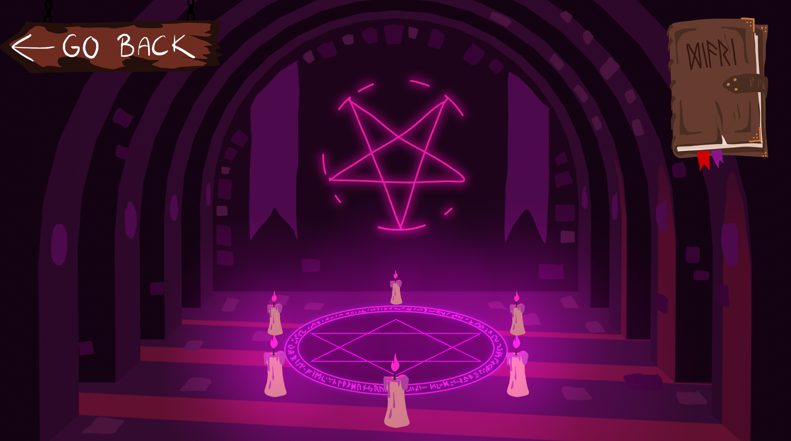
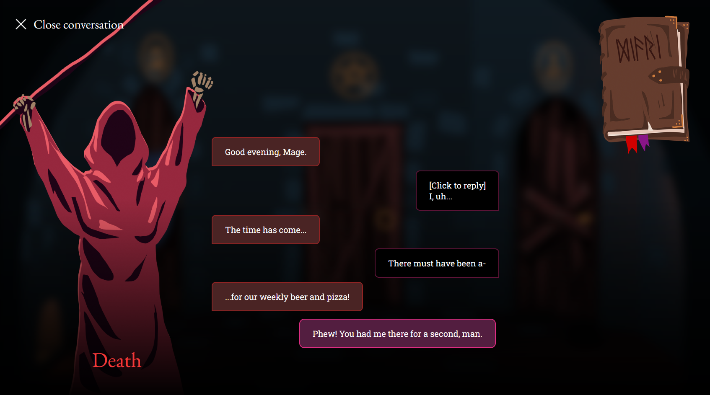

DEATH WISH is a light-hearted story puzzle game where you take the role of a mage helping Death himself. Find out what is troubling the spirits, write notes in your trusty notepad and figure out how to solve the problem!

Brew potions in the alchemy room, call people on the crystal ball, or summon the dead directly in the ritual hall. Some problems have open-ended solutions!

For this game, I worked on art, UI, parts of the story, and some gameplay elements.

