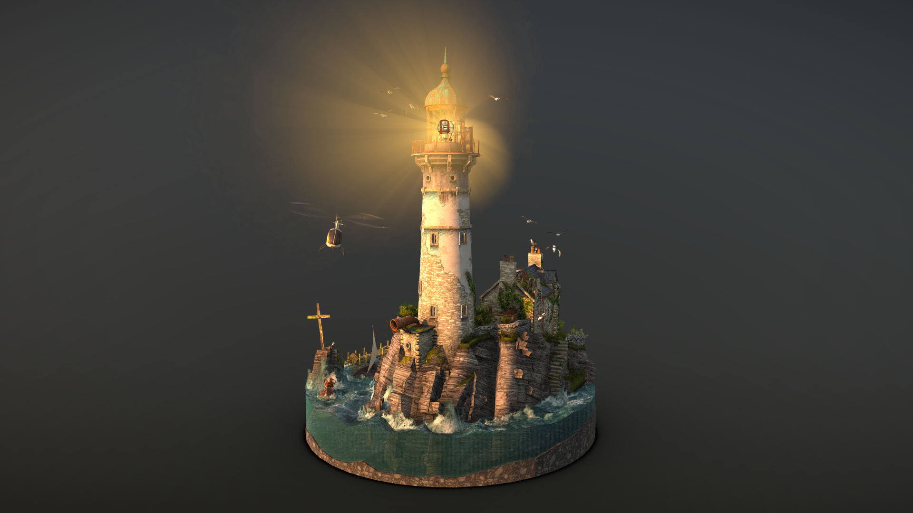
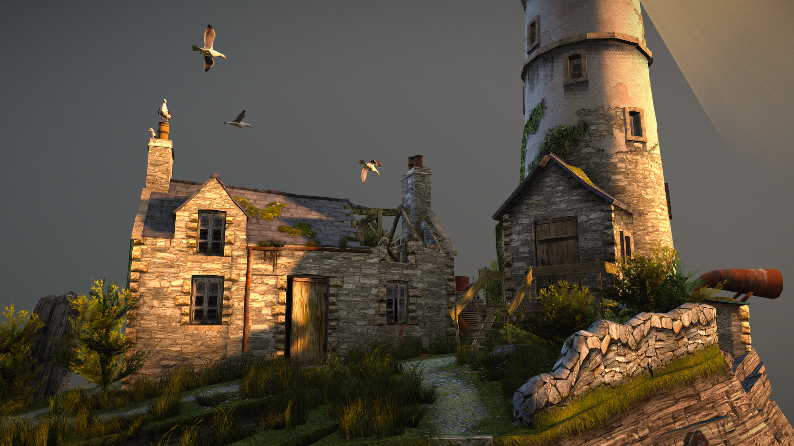
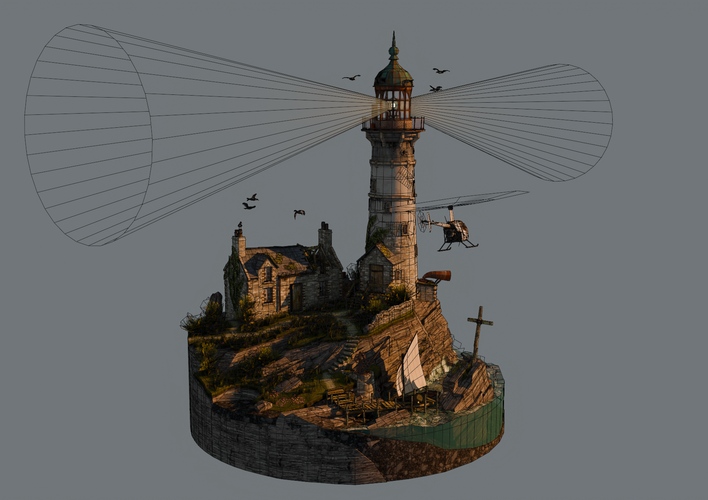

An old lighthouse in Scotland is in the final days of its service.

This morning, the calm splashing of the sea was interrupted by an unannounced helicopter flight. Are they finally coming to decommission the lighthouse? The old lighthouse keeper hopes it’s just a supply helicopter - he would dearly miss the little island and his seagull friends.

This is a diorama for the 3D1 Course at Digital Arts and Entertainment Howest.

Final grade was 20/20 points.

Since uploading, I’ve discovered that some of the seagull poses didn’t export properly. Rather funnily, the seagull at the top of the lighthouse now has a rod running through his head. I may do a reupload after grading is finished.

